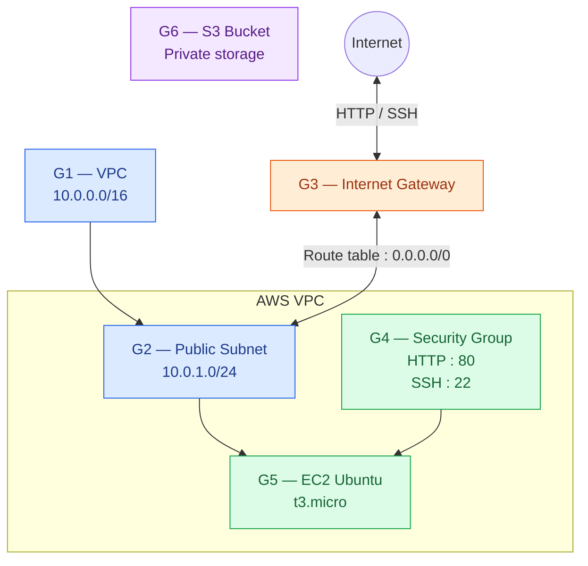

# Travaux pratiques collaboratifs
## À propos
Ce dépôt regroupe des travaux pratiques collaboratifs dans lesquels les étudiants travaillent en groupes pour réaliser différentes tâches et construire ensemble une solution complète.
## Évaluation
Les contributions et l'historique des commits Git seront pris en compte dans la note du **Contrôle Continu (CC)**.
**Chaque contribution laisse une trace, et cette trace compte dans votre note !**
## Workflow Git
Chaque classe doit travailler sur sa propre branche.
### 1. Cloner le dépôt
```bash
git clone <repository-url>
cd Collaborative-Terraform-Labs
```
### 2. Basculer vers la branche de la classe
```bash
git checkout CIM-J-A
git pull origin CIM-J-A
```
### 3. Réaliser le travail demandé
Chaque groupe doit modifier uniquement les fichiers correspondant à sa tâche et respecter la structure du projet définie pour le TP.
### 4. Enregistrer et envoyer les modifications
```bash
git add .
git commit -m "Groupe 1 : réalisation de la tâche assignée"
git push -u origin CIM-J-A
```
# LAB 1
